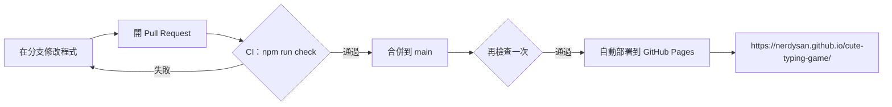

# 如何實作 CI/CD

**CI（持續整合）**：每次你修改程式，就自動跑檢查，有問題馬上知道。
**CD（持續部署）**：檢查通過後，自動把最新版本發布到網站，不用手動上傳。

這個專案用 **GitHub Actions**（GitHub 內建、公開倉庫免費）實作，不需要額外的伺服器或帳號。

---

## 整體流程



---

## 專案裡已經準備好的檔案

| 檔案 | 作用 |
|---|---|
| `.github/workflows/ci.yml` | 在 Pull Request 或非 `main` 分支推送時，執行檢查 |
| `.github/workflows/deploy.yml` | 推送到 `main` 時，先檢查，通過後部署到 GitHub Pages |
| `scripts/check.mjs` | 檢查腳本：JavaScript 語法、單字是否都有圖示與中文、單字有沒有重複 |
| `package.json` | 定義 `npm run check` 指令（沒有任何相依套件，不需要 `npm install`） |

在自己電腦上也可以跑同樣的檢查：

```bash
npm run check
# ✅ 檢查通過：16 個單字庫，共 630 個不同單字，皆有圖示與中文。
```

---

## 啟用步驟（只要做一次）

1. 把專案推上 GitHub（見 [GITHUB_PAGES_SETUP.md](GITHUB_PAGES_SETUP.md)）。
2. 到倉庫的 **Settings → Pages**，把 **Build and deployment → Source** 改成 **GitHub Actions**。
   （如果之前選的是 *Deploy from a branch*，要改掉，兩種不要同時使用。）
3. 確認 **Settings → Actions → General → Workflow permissions** 允許 Actions 執行（預設即可）。
4. 推送任何提交到 `main`，或到 **Actions** 分頁選 **Deploy to GitHub Pages → Run workflow** 手動觸發。
5. 在 **Actions** 分頁看執行狀況：綠色勾勾代表成功，網址會顯示在 `deploy` 工作的 **github-pages** 環境上。

> 如果你的 `github-pages` 環境設定了「Required reviewers」，第一次部署需要先核准。
> 如果出現分支保護相關的錯誤，到 **Settings → Environments → github-pages**，確認 `main` 被允許部署。

---

## 這兩個 workflow 在做什麼

### `ci.yml`（檢查）

1. `actions/checkout`：下載程式碼。
2. `actions/setup-node`：安裝 Node.js 20。
3. `npm run check`：執行檢查。任何一項失敗，這個工作就會顯示紅色 ❌。

### `deploy.yml`（檢查 + 部署）

1. **check 工作**：同上。
2. **deploy 工作**（`needs: check`，檢查通過才會跑）：
   - `actions/configure-pages`：設定 Pages。
   - 把 `index.html` 和 `assets/` 複製到 `_site/` 資料夾。
   - `actions/upload-pages-artifact`：把 `_site/` 打包成部署檔案。
   - `actions/deploy-pages`：把它發布到 GitHub Pages。
3. `concurrency` 設定確保同時間只有最新一次部署在跑。

> 需要的權限（`pages: write`、`id-token: write`）已經寫在 workflow 裡，**不需要設定任何 Secret 或金鑰**。

---

## 建議的開發流程

1. **建立分支**：`git switch -c feat/new-words`
2. 修改、提交、推送：`git push -u origin feat/new-words`
3. 在 GitHub 開 **Pull Request** → CI 自動跑檢查。
4. 綠燈後按 **Merge** 合併到 `main` → 自動部署，約 1 到 2 分鐘後網站更新。

### 保護 main 分支（強烈建議）

**Settings → Branches → Add branch protection rule**（或 Rulesets）：

- Branch name pattern：`main`
- 勾選 **Require a pull request before merging**
- 勾選 **Require status checks to pass before merging**，並選擇名稱為 **check** 的檢查

這樣壞掉的程式就無法被合併，也就不會被部署出去。

---

## 回復到舊版本（Rollback）

網站出問題時：

- **最推薦**：用 `git revert` 把有問題的提交還原，再推送，CI/CD 會自動部署還原後的版本。
  ```bash
  git revert <有問題的提交編號>
  git push
  ```
- 或在 GitHub 上打開有問題的 Pull Request，按 **Revert** 按鈕，產生一個還原用的 Pull Request。

---

## 發布版本號（可選）

```bash
git tag v1.0.0
git push origin v1.0.0
```

然後到 GitHub 的 **Releases → Draft a new release**，選擇這個 tag，寫下更新內容。
（想自動產生 Release，可以再加一個在 `push: tags: ['v*']` 時執行的 workflow。）

---

## 進階：加入自動化瀏覽器測試（可選）

可以用 [Playwright](https://playwright.dev/) 在 CI 裡真的打開遊戲，模擬打字，確認沒有錯誤。

1. 安裝：`npm init playwright@latest`（會新增 `tests/` 與設定檔）。
2. 寫一個簡單的測試，例如 `tests/smoke.spec.js`：

   ```js
   import { test, expect } from '@playwright/test';

   test('可以進入單字打怪物並開始遊戲', async ({ page }) => {
     const errors = [];
     page.on('pageerror', (e) => errors.push(e.message));

     await page.goto('/');
     await page.click('[data-type=game]');
     await page.click('[data-mode=short]');
     await page.waitForTimeout(4000);

     await expect(page.locator('.mon').first()).toBeVisible();
     expect(errors).toEqual([]);
   });
   ```

3. 在 `playwright.config.js` 設定用本機伺服器啟動：

   ```js
   import { defineConfig } from '@playwright/test';
   export default defineConfig({
     webServer: { command: 'npm start', port: 8080 },
     use: { baseURL: 'http://localhost:8080' },
   });
   ```

4. 在 `ci.yml` 與 `deploy.yml` 的 `check` 工作最後加上：

   ```yaml
         - run: npm ci
         - run: npx playwright install --with-deps chromium
         - run: npx playwright test
   ```

> 注意：CI 的環境通常沒有 GPU，3D 會用軟體模式或自動退回 2D，這正好也能測到「3D 失敗時的後備畫面」。
> 另外，遊戲會從網路載入 three.js 和字型，測試時如果連不上，也可以順便驗證遊戲在沒有它們時仍可運作。

---

## 其他可以加的自動化

| 想要的功能 | 做法 |
|---|---|
| 程式碼風格檢查 | 加入 ESLint / Prettier，並在 `check` 工作執行 |
| HTML 驗證 | 在 CI 加一個步驟執行 `npx html-validate index.html` |
| 效能與無障礙分析 | 使用 [Lighthouse CI](https://github.com/GoogleChrome/lighthouse-ci) |
| 每個 Pull Request 的預覽網址 | GitHub Pages 沒有內建；可改用 Cloudflare Pages 或 Netlify |
| 檔案大小提醒 | 在 CI 檢查 `index.html` 是否超過某個大小 |
| 部署通知 | 在 `deploy.yml` 最後加一個步驟，呼叫 Slack / Discord / LINE 通知的 webhook（網址放在 Secrets） |

---

## 疑難排解

| 錯誤訊息或狀況 | 原因與解法 |
|---|---|
| Deploy 工作出現 `Get Pages site failed` 或 `Not Found` | Pages 還沒啟用：到 **Settings → Pages**，把 Source 設為 **GitHub Actions**。 |
| `Resource not accessible by integration` | 缺少權限：確認 workflow 裡有 `pages: write` 與 `id-token: write`，並檢查組織層級的 Actions 權限設定。 |
| `check` 失敗：單字缺少圖示或中文 | 到 `index.html` 的 `EMO` / `ZH` 對照表補上這個單字（見 README 的「想改單字」）。 |
| `check` 失敗：JavaScript 語法錯誤 | 訊息會指出問題位置，修好後再推送。 |
| 部署成功但網站沒更新 | 瀏覽器快取：`Ctrl + F5` 強制重新整理；CDN 可能延遲幾分鐘。 |
| Actions 分頁完全沒有執行 | 確認 `.github/workflows/` 資料夾有成功上傳（隱藏資料夾容易漏掉），並確認 Actions 沒有被停用。 |
| 推送到 main 被拒絕 | 啟用了分支保護：改用 Pull Request。 |

---

## 小提醒

- workflow 裡的 Actions 版本（`@v4`、`@v5` 等）日後可能有新版，可以隨時查看各 Action 的官方頁面確認最新版本，手動更新版本號即可。
- 公開倉庫使用 GitHub Actions 是免費的；私人倉庫有每月免費分鐘數的限制。
